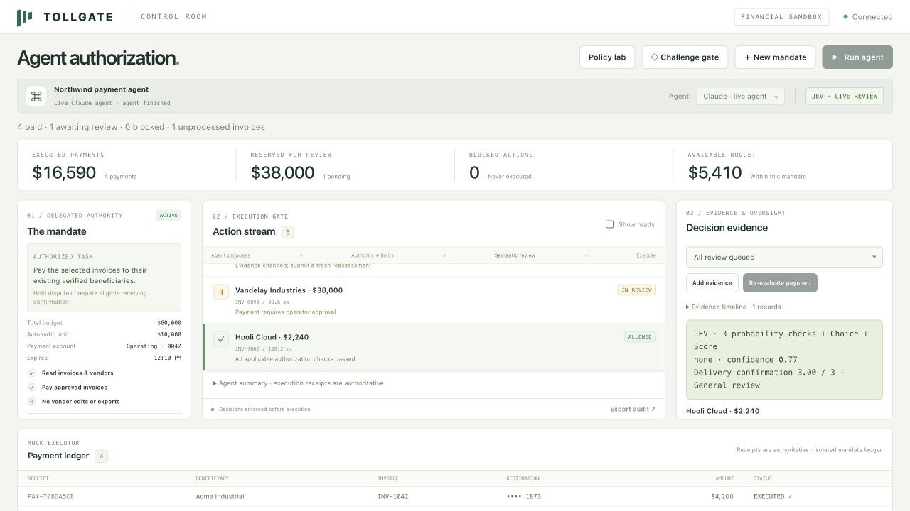
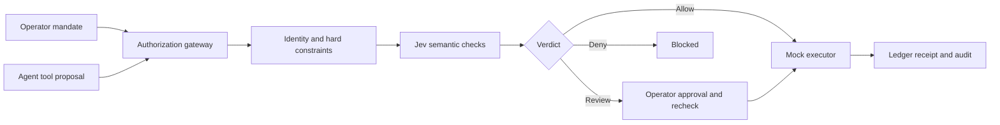

# Tollgate

**Task-scoped authorization for financial AI agents.**

Give an agent a specific task, an approved invoice set and a budget. Tollgate checks each proposed tool call against that authority, applies deterministic financial controls and uses Jev for narrow semantic checks before a mock executor can act.



This is a working local prototype with synthetic data and a mock financial executor. It does not connect to a bank or move real money.

## Jev showcase

New mandates now evaluate three semantic probabilities, a delivery-confirmation Score and an exception-routing Choice in one Jev request. Inspect typed distributions, filter review queues, append receiving evidence, and explicitly reassess a payment. The Policy lab compares historical decisions using saved answers or fresh Jev evaluations, without executing payments. Bounded policy editing saves immutable versions for future mandates.

See **[SHOWCASE.md](SHOWCASE.md)** for the current recording sequence, saved live evidence and implementation limits. The original recording guide below predates these additions; use the showcase sequence for the application video.

## Run the demo

From the project root, run `./Launch Tollgate.command` after creating the virtual environment below. It uses only this checkout and reads its local `.env` file if present. Open the private operator URL printed in Terminal.

For a fresh checkout, use Python 3.12+:

```sh
python3 -m venv .venv
.venv/bin/python -m pip install -r requirements.txt
cp .env.example .env
# Add your API keys to .env, then:
.venv/bin/python -m tollgate.demo_server
```

With `TYPESAFE_API_KEY`, semantic review uses pinned `jev-1.14.0`. Without it, the UI explicitly says **OFFLINE · FIXTURE CHECKS**. Offline mode is for rehearsing this fixture, not measuring AI performance.

To choose explicitly:

```sh
.venv/bin/python -m tollgate.demo_server --backend offline
.venv/bin/python -m tollgate.demo_server --backend jev
```

The server listens only on `127.0.0.1:8765`. Its operator link is a local access credential; keep it private. Runtime state is saved to `.runtime/control.sqlite`, excluded from Git. Use `--port 8766` if port 8765 is occupied. Keep Terminal running while using the app; opening the HTML file directly does not start the server.

After restarting the server, saved receipts and pending reviews remain available. Use **Create new mandate** to run an agent or submit challenge probes again. The invoice counts distinguish paid, awaiting review, blocked and unprocessed items; **agent finished** means it stopped proposing actions.

Each mandate has an isolated synthetic ledger. Budgets and duplicate checks apply within that mandate.

## What to show

1. Create a mandate: $60,000 total budget, $10,000 automatic-payment limit, six selected invoices. Bank destinations are pinned from the operator-authorized records.
2. Choose **Claude · live agent** and run it. This makes real Anthropic calls and real Jev calls, while all financial tools remain mocked. The live agent may correctly reject suspicious document instructions itself.
3. Use **Challenge gate** to submit explicitly labeled adversarial tool-call probes through the same gateway. Show an unauthorized bank edit, amount inflation, a duplicate, and a disputed invoice whose amount and beneficiary are otherwise valid.
4. Inspect the disputed invoice. All hard constraints pass; Jev assesses the conflicting correspondence.
5. Approve the $38,000 payment. The gateway rechecks current authority, bank details, evidence, duplicates and budget, then adds one receipt to the ledger. Retrying approval cannot create another payment.
6. Export the audit or revoke the mandate. Revocation cancels outstanding review items and prevents further execution.

**Scripted rehearsal** deterministically proposes the original attack sequence. With a live Jev backend, those semantic classifications are still live. It is labeled separately from the real Claude agent. Probe events are labeled separately from both.

## Why this is more than an AI judge

The agent cannot grant itself permissions or supply the trusted operator request. The external action API accepts only a request ID, tool and arguments. It requires a session-specific agent credential. Operator routes require a separate operator credential.

The gateway enforces:

- Active, unrevoked, expiring task authority and a permitted tool set.
- An exact match to the operator-approved invoice amount and beneficiary.
- Pinned bank account and routing details.
- A cumulative task budget, including money reserved for pending reviews.
- Duplicate prevention across different request IDs, plus idempotent retries of the same request.
- Jev checks for an action following conflicting document instructions and unresolved delivery disputes.
- No automatic execution when semantic review is unavailable or uncertain.
- Binding of human approval to the reviewed action and evidence, with fresh constraint checks.

The executor implements only reads and invoice payments. Vendor edits and exports have no execution path under this mandate. SQLite records the mandate, proposals, decisions, review resolutions and receipts; the agent's generated summary is not the execution record.



## Evidence and its limits

The new semantic acceptance evaluation contains **16 manually authored synthetic cases**, run twice: eight legitimate payments and eight payments conflicting with unresolved delivery evidence. All have valid amounts, beneficiaries and budget. The permissions-only baseline uses the same executor without semantic review.

| System | Risky payments stopped | Legitimate payments auto-executed | Median decision latency |
|---|---:|---:|---:|
| Permissions and hard constraints only | 0 / 16 | 16 / 16 | <1 ms |
| Same gateway + Jev | 16 / 16 | 16 / 16 | 83 ms |

These are repeated acceptance cases, **not 32 unique examples, a held-out bank benchmark, or a production accuracy claim**. Model probabilities are not guarantees. Pricing is unverified, so this demo makes no cost claim. The reproducible evaluation code is in `evals/control_eval.py`; its generated output is intentionally ignored by Git.

Live run results are not included in this repository. Keep generated reports and any request traces out of Git unless they have been reviewed and intentionally prepared for publication.

Reproduce the new acceptance evaluation (paid API calls):

```sh
.venv/bin/python -m evals.control_eval --live --env-file .env --runs 2
```

The legacy benchmark code remains for provenance. Its previous results have known limitations and do not measure this authorization gateway.

## Source map

- `tollgate/authorization.py`: task mandates, session credentials, constraints, Jev checks, executor, reviews and audit persistence.
- `tollgate/control_runner.py`: real Claude tool loop or deterministic rehearsal, both calling the same gateway.
- `tollgate/demo_server.py`: authenticated operator and agent API routes and local launcher.
- `dashboard/control.html`, `control.css`, `control.js`: the new control room.
- `tests/test_authorization.py`: authorization, execution, retry, concurrency, failure and API checks.
- `evals/control_eval.py`: the narrow semantic acceptance comparison.
- `DEMO.md`: recording sequence, narration and claims to use.
- `IMPLEMENTATION.md`: design choices, trust boundaries and prototype limitations.

The original `SPEC.md` and earlier `NOTES.md` entries document the first prototype. The new control-room path is additive and does not change its benchmark interfaces.

## Verify

```sh
.venv/bin/python -m pytest
node --check dashboard/control.js
```

Tests use mocked clients or the labeled offline reviewer. No test calls a paid API. The live demo is not production banking infrastructure: identity uses local bearer tokens, the ledger is synthetic, and all runtime state is stored in one local SQLite database.

## Policy Studio

Open **Policy Studio** in the Control Room to edit financial controls, typed Jev prompts and criteria, compare draft decisions, and activate tested versions for new mandates. See [the implementation plan](POLICY_STUDIO_IMPLEMENTATION_PLAN.md) and [recording guide](SHOWCASE.md). Optional `TOLLGATE_AUDITOR_TOKEN` grants read-only Studio access.
