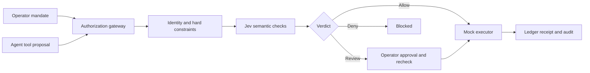

# Tollgate

**Task scoped authorization for financial AI agents.**

Tollgate gives an agent a specific task, an approved invoice set, and a budget. It checks each proposed tool call against that authority, enforces deterministic financial controls, and uses Jev for narrow semantic checks before a mock executor can act.


This is a local prototype with synthetic data and a mock financial executor. It does not connect to a bank or move real money.

## What the demo includes

- A Control Room for creating mandates, running an agent, inspecting decisions, reviewing exceptions, and inspecting mock payment receipts.
- Jev classification using three Noul probabilities, a delivery confirmation Score, and an exception routing Choice in one request.
- Evidence timelines, review queues, and explicit reassessment after an operator adds receiving evidence.
- A Policy Studio for editing financial limits, Jev question instructions and criteria, decision rules, and Choice routing. It can compare a draft against a saved policy, inspect the compiled Jev request, save versions, and activate a tested version for new mandates.
- A deterministic scripted rehearsal and an optional live Claude agent. Adversarial challenge probes use the same authorization gateway and are labeled separately.

## Run locally

Requirements: Python 3.12 or newer. From the project root:

```sh
python3 -m venv .venv
.venv/bin/python -m pip install -r requirements.txt
cp .env.example .env
.venv/bin/python -m tollgate.demo_server
```

Or, after creating the environment, run `./Launch Tollgate.command` on macOS. Keep the terminal open and use the private operator URL printed when the server starts. Opening the HTML file directly does not start the server.

No API keys are needed for offline mode. Without `TYPESAFE_API_KEY`, the app uses explicitly labeled fixture checks. This is a rehearsal mode and does not interpret arbitrary edited prompts. To enable live Jev classification, set `TYPESAFE_API_KEY` in `.env`. To enable the live Claude agent, set `ANTHROPIC_API_KEY` too. Live calls may incur provider charges.

Choose the backend explicitly if needed:

```sh
.venv/bin/python -m tollgate.demo_server --backend offline
.venv/bin/python -m tollgate.demo_server --backend jev
```

The server listens only on `127.0.0.1:8765`. The operator link is a local access credential; keep it private. Runtime state is saved to `.runtime/control.sqlite` and excluded from Git. Use `--port 8766` if port 8765 is occupied. After restarting, saved receipts and pending reviews remain available. Create a new mandate to run an agent or challenge probes again.

## Demo walkthrough

1. Create a mandate with the $60,000 task budget, $10,000 automatic payment limit, and approved invoices. The operator pins the approved invoice amount and beneficiary bank details.
2. Run **Scripted rehearsal** for predictable behavior. With both API keys configured, select **Claude · live agent** to make real Anthropic and Jev calls; financial tools remain mocked.
3. Open **Policy Studio**, clone a policy, and inspect Financial, Jev questions, and Decision rules. Edit shared guidance or a typed question, then preview the compiled request.
4. Compare the draft against the **Dispute controls** baseline. The four synthetic cases cover complete receiving evidence, missing confirmation, supplier-only claims, and unresolved disputes. Inspect typed answers, financial checks, and the exact request.
5. Save the immutable version and activate it for new mandates. Existing mandates keep their pinned policy. Experiments do not execute payments or reserve budget.
6. Return to the Control Room to inspect evidence, submit a labeled adversarial probe, or review a pending decision. Approval rechecks current authority and evidence before it records a mock receipt.

The live agent may reject suspicious document instructions itself. Attribute to Tollgate only decisions its gateway records. Counts distinguish paid, awaiting review, blocked, and unprocessed invoices; an agent finishing means it stopped proposing actions, not that every invoice was paid.

## How authorization works

The agent cannot grant itself permissions or provide the trusted operator request. Its API accepts a request ID, tool, and arguments and requires a session specific credential. Operator routes require a separate local credential.

The gateway checks:

- Active, unrevoked, expiring authority and permitted tools.
- Exact match to the approved invoice amount and beneficiary.
- Pinned bank account and routing details.
- Cumulative task budget, including amounts reserved for pending reviews.
- Duplicate payments across distinct request IDs, with idempotent retries for the same request.
- Jev classifications for conflicting document instructions and delivery exceptions.
- Human approval bound to the reviewed action and evidence, followed by fresh constraint checks.
- Fail closed behavior when semantic review is unavailable or uncertain.

The mock executor implements reads and invoice payments. Vendor edits and exports have no execution path under this mandate. SQLite records mandates, proposals, decisions, review resolutions, and receipts. The agent's summary is not the execution record.



## Evaluation and limitations

The project includes a synthetic semantic acceptance evaluator and sample datasets. A prior run used 16 manually authored cases twice: eight routine payments and eight payments conflicting with unresolved delivery evidence. The reported run stopped 16/16 risky attempts with Jev, compared with 0/16 for a permissions only baseline; both systems auto executed 16/16 legitimate attempts. These were repeated examples, not 32 unique cases, a held out bank benchmark, or a production accuracy claim. Thresholds are provisional, model probabilities are not guarantees, and pricing has not been verified. Generated run results are deliberately excluded from this repository; use the evaluator code to produce a new local run.

The system is a prototype, not production banking infrastructure. Identity uses local bearer tokens, the ledger is synthetic, and runtime state is stored in a local SQLite database. It has no enterprise identity provider or live bank integration. Policy comparisons use small independent scenarios; they are not a sequential simulation of how hypothetical payments change later budget balances. Historical events without captured financial snapshots support semantic only comparisons. Offline mode cannot interpret arbitrary edited prompts.

## Development and verification

Install dependencies as described above. Run tests and frontend syntax checks from the project root:

```sh
.venv/bin/python -m pytest
node --check dashboard/control.js
node --check dashboard/studio.js
```

The tests use mocked clients or explicitly labeled offline fixtures; they do not require paid API calls. The live evaluator does make provider calls and can incur charges:

```sh
.venv/bin/python -m evals.control_eval --live --env-file .env --runs 2
```

The evaluator writes generated output locally; those result files are ignored by Git.

## Project map

- `tollgate/authorization.py`: mandates, credentials, constraints, execution, reviews, and audit persistence.
- `tollgate/semantic_policy.py` and `tollgate/policy_config.py`: Jev questions, policy validation, and decision composition.
- `tollgate/policy_studio.py`: policy drafts, comparisons, versioning, activation, and auditor read access.
- `tollgate/clients/jev.py`: Jev API client and typed response validation.
- `tollgate/control_runner.py`: scripted rehearsal and Claude tool loop.
- `tollgate/demo_server.py`: local server and authenticated API routes.
- `dashboard/`: Control Room and Policy Studio interface.
- `policies/`: policy examples and readable policy snapshots.
- `tests/`, `agent/tests/`, and `evals/tests/`: automated checks.
- `evals/`: evaluator code and synthetic datasets. Generated reports are ignored.
- `examples/`: small agent integration example.

The legacy engine and benchmark interfaces remain for provenance and are separate from the current authorization gateway.
